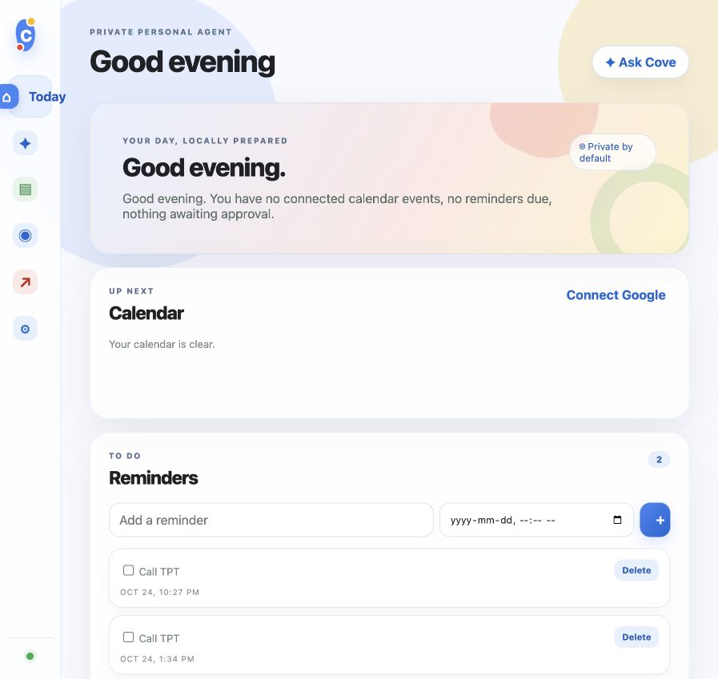
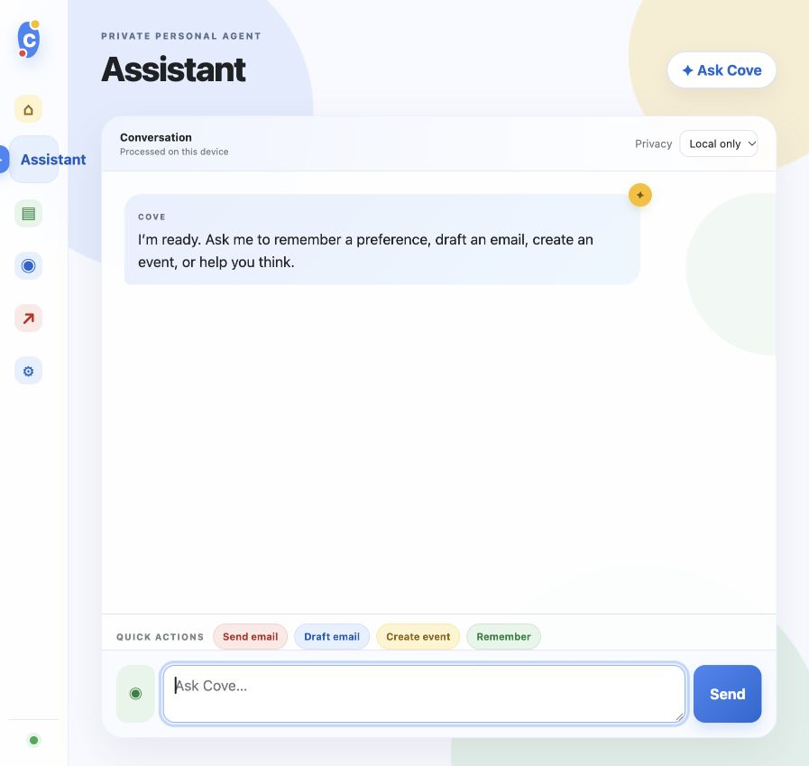
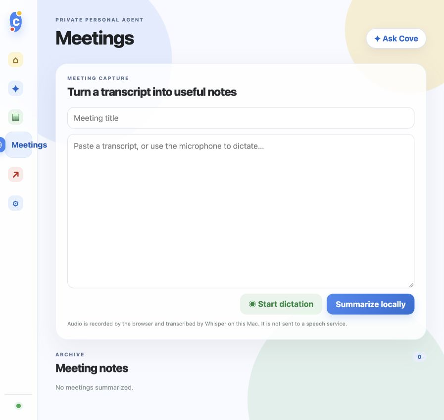
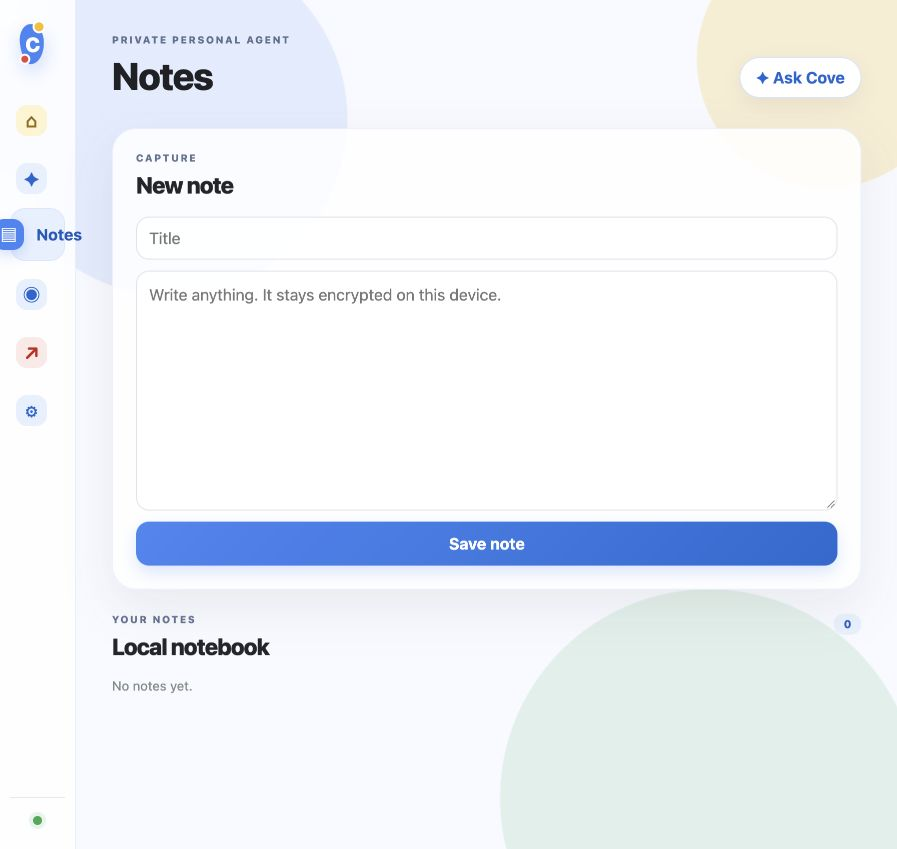
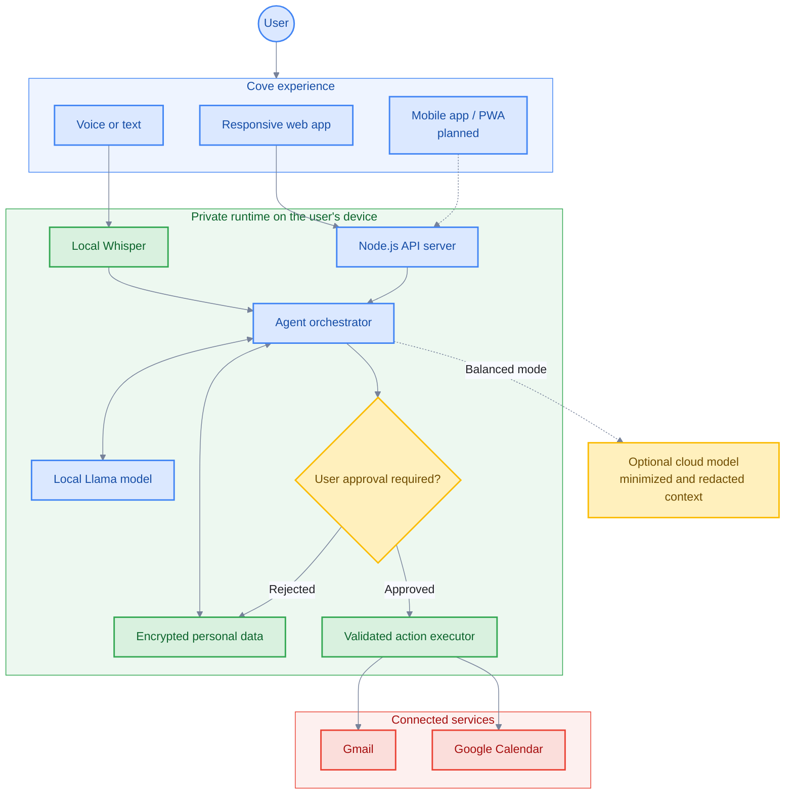

# Cove

**A private, local-first personal AI assistant that learns how you work and helps with everyday tasks.**

Cove combines an on-device language model, encrypted personal memory, voice input, and user-approved integrations in one responsive web application. It can remember preferences, manage notes and reminders, summarize meetings, draft and send email, and create calendar events—while keeping the user in control of every external action.

> [!IMPORTANT]
> Cove is currently an MVP intended for local development and testing. It is not yet production-hardened or designed to be exposed to the public internet.

## Screenshots

| Today | Assistant |
| --- | --- |
|  |  |

| Meeting notes | Encrypted notes |
| --- | --- |
|  |  |

## What Cove can do

- Chat with a locally running AI model.
- Learn confirmed preferences and store them in encrypted local memory.
- Create and manage notes and reminders.
- Record voice commands and transcribe them locally with Whisper.
- Turn meeting transcripts into summaries and action items.
- Search connected Gmail messages.
- Draft or send email after showing a preview and receiving approval.
- Read upcoming Google Calendar events and propose new events.
- Prepare a daily brief from calendars, reminders, and pending approvals.
- Maintain a visible history of proposed, approved, rejected, and completed actions.
- Optionally escalate minimized, redacted requests to a cloud model in Balanced mode.

## Privacy model

Cove is local-only by default.

| Area | Behavior |
| --- | --- |
| Language model | Runs through a local OpenAI-compatible server, with Ollama as the default. |
| Voice | Browser audio is sent only to Cove on `127.0.0.1` and transcribed locally with Whisper. |
| Personal data | Memories, notes, reminders, meetings, OAuth tokens, and action history are encrypted on disk. |
| External actions | Email sending and calendar changes wait for explicit user approval. |
| Cloud models | Disabled by default and used only when Balanced mode is deliberately configured and selected. |
| Network exposure | The Cove server binds only to `127.0.0.1`. |

## Architecture



Solid connections represent the current MVP. Dashed connections represent planned or optional capabilities.

## Quick start

### Requirements

- macOS for the current local-model and voice setup scripts
- Node.js 24 or newer
- [Ollama](https://ollama.com/) for the default local model
- `uv` and `ffmpeg` for local voice transcription

No npm dependency installation is currently required.

### 1. Configure Cove

Create a local environment file:

```bash
cp .env.example .env
```

The defaults run Cove on port `4312` with Ollama and `llama3.1:8b`.

### 2. Set up the local model

```bash
npm run model:setup
npm run model:start
```

The default quantized model uses approximately 4.9 GB of disk space and has no per-request API charge.

### 3. Set up local voice

```bash
npm run voice:setup
```

This installs OpenAI Whisper into the project-local Python environment and downloads the English `base.en` model to `.cache/whisper`. The model download is approximately 140 MB.

### 4. Start Cove

```bash
npm start
```

Open [http://127.0.0.1:4312](http://127.0.0.1:4312).

To use a different port temporarily:

```bash
PORT=4313 npm start
```

## Example requests

```text
Remember that I prefer meetings after 10 AM.

Remind me to call the dentist tomorrow morning.

Draft a warm email to Sam thanking them for the update.

Send an email to alex@example.com about lunch tomorrow.

Schedule a project review tomorrow at 3 PM.

Summarize what I need to focus on today.
```

Email sending and event creation produce an approval card before Cove performs the action.

## Connect Google

Cove uses Google OAuth 2.0 to connect Gmail and Google Calendar without storing a Google password.

### Google Cloud setup

1. Create or select a project in Google Cloud Console.
2. Enable the Gmail API and Google Calendar API.
3. Configure the OAuth consent screen.
4. Add your Google account as a test user while the application remains in testing mode.
5. Create an OAuth 2.0 client with the **Web application** type.
6. Add this authorized redirect URI:

```text
http://127.0.0.1:4312/api/integrations/google/callback
```

7. Add the credentials to `.env`:

```bash
GOOGLE_CLIENT_ID=your-client-id
GOOGLE_CLIENT_SECRET=your-client-secret
GOOGLE_REDIRECT_URI=http://127.0.0.1:4312/api/integrations/google/callback
```

8. Restart Cove and select **Settings → Connect Google**.

If Cove runs on another port, update both `PORT` and `GOOGLE_REDIRECT_URI`, then add the matching redirect URI in Google Cloud.

Cove requests access for identity/email, read-only Gmail lookup, Gmail composition, and calendar events. OAuth tokens are stored in the encrypted local data store.

## Configuration

| Variable | Default | Purpose |
| --- | --- | --- |
| `PORT` | `4312` | Local Cove server port. |
| `COVE_LOCAL_KEY` | Generated locally | Optional encryption-key source. |
| `LOCAL_LLM_BASE_URL` | `http://127.0.0.1:11434/v1` | OpenAI-compatible local model endpoint. |
| `LOCAL_LLM_MODEL` | `llama3.1:8b` | Local model identifier. |
| `GOOGLE_CLIENT_ID` | Empty | Google OAuth client ID. |
| `GOOGLE_CLIENT_SECRET` | Empty | Google OAuth client secret. |
| `GOOGLE_REDIRECT_URI` | Local callback on port 4312 | Google OAuth callback. |
| `CLOUD_ESCALATION_ENABLED` | `false` | Enables the Balanced-mode cloud adapter. |
| `CLOUD_LLM_BASE_URL` | Empty | OpenAI-compatible cloud endpoint. |
| `CLOUD_LLM_API_KEY` | Empty | Cloud provider API key. |
| `CLOUD_LLM_MODEL` | Empty | Cloud model identifier. |

The first run creates `.data/local.key` with owner-only permissions. Back up this key if encrypted Cove data must remain readable. Losing the key means losing access to that encrypted data.

## Optional cloud escalation

Cloud escalation remains off unless it is explicitly configured:

```bash
CLOUD_ESCALATION_ENABLED=true \
CLOUD_LLM_BASE_URL=https://provider.example/v1 \
CLOUD_LLM_API_KEY=your-key \
CLOUD_LLM_MODEL=your-model \
npm start
```

Balanced mode sends only the current request and a small set of confirmed preferences after basic redaction. Local-only mode never invokes the cloud adapter.

Before using a real provider, add provider-specific retention controls, stronger PII detection, endpoint tests, contractual review, and a visible per-request disclosure. The current generic adapter is scaffolding rather than a complete privacy guarantee.

## Development

Run Cove with automatic server restarts:

```bash
npm run dev
```

Run the test suite:

```bash
npm test
```

Run the local model behavior and safety benchmark:

```bash
npm run model:benchmark
```

### Available scripts

| Command | Description |
| --- | --- |
| `npm start` | Starts Cove. |
| `npm run dev` | Starts Cove in watch mode. |
| `npm test` | Runs the Node.js test suite. |
| `npm run model:setup` | Installs or prepares the default Ollama model. |
| `npm run model:start` | Starts or verifies the Ollama runtime. |
| `npm run model:benchmark` | Runs the local-model benchmark. |
| `npm run voice:setup` | Installs Whisper and downloads the local voice model. |
| `npm run model:setup:mlx` | Prepares the optional MLX/Qwen experiment. |
| `npm run model:start:mlx` | Starts the optional MLX model server. |

## Project structure

```text
src/
├── agent/
│   ├── executor.ts       External action execution
│   ├── models.ts         Local and optional cloud model adapters
│   ├── orchestrator.ts   Conversation and workflow routing
│   ├── policy.ts         Approval and risk rules
│   └── tools.ts          Tool definitions and validation
├── integrations/
│   └── google.ts         Gmail, Calendar, and OAuth integration
├── security/
│   └── redact.ts         Cloud-context minimization and redaction
├── storage/
│   └── encryptedStore.ts Encrypted JSON persistence
├── web/                  Responsive Cove interface
├── config.ts             Environment configuration
├── server.ts             Local HTTP API and static server
└── types.ts              Shared application types

scripts/                  Model, voice, and benchmark utilities
test/                     Behavior, policy, security, and storage tests
docs/                     Development plan and roadmap
```

## Current limitations

- Cove is a single-user local application.
- The mobile experience is responsive web UI; native mobile packaging is planned.
- Voice transcription currently targets English with Whisper `base.en`.
- Meeting capture records dictated segments rather than joining live calls.
- Google OAuth applications in testing mode require explicitly configured test users.
- The local encrypted JSON store is appropriate for an MVP, not multi-device synchronization.
- Cloud redaction is intentionally basic and should not be treated as a formal privacy boundary.

## Roadmap

Near-term priorities include:

- native or installable mobile delivery;
- background reminders and notifications;
- contacts and safer recipient resolution;
- richer meeting capture and speaker-aware summaries;
- additional integrations for notes and messaging;
- stronger evaluations, observability, and policy enforcement;
- user-controlled encrypted synchronization across devices.

See [`docs/DEVELOPMENT_PLAN.md`](docs/DEVELOPMENT_PLAN.md) for the broader implementation plan.
